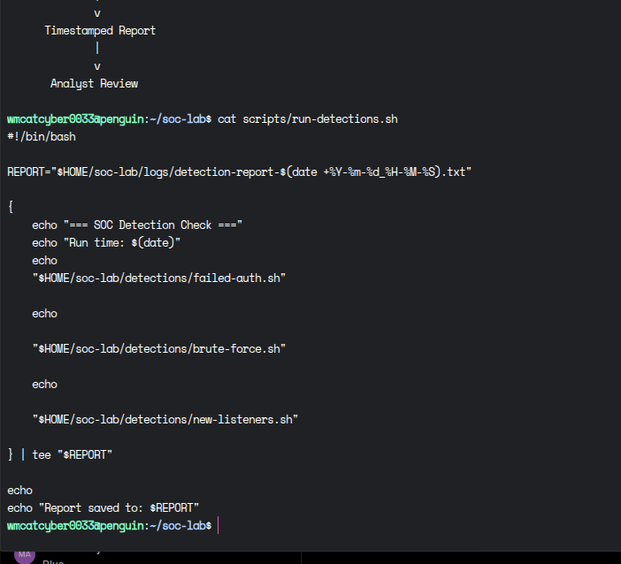

# BlueHarbor SOC | Technical Evidence

This folder contains screenshots documenting hands-on cybersecurity activities performed in my Debian Linux SOC home lab.

## Detection Engineering

The evidence includes:

- Bash-based security detection scripts
- Failed authentication monitoring
- Brute-force detection logic
- Network listening-port monitoring
- Automated detection reporting

## Purpose

These screenshots provide supporting evidence of practical Linux security monitoring, detection engineering, and SOC investigation workflows.

All activities were performed in a controlled home lab environment for cybersecurity training and skill development.

---

## SOC Detection Runner | Bash Automation

This screenshot shows the Bash detection runner used in my Debian Linux SOC home lab.

The script coordinates three security checks:
- Failed authentication detection
- Brute-force login detection
- New listening-port detection

It also generates a timestamped report for analyst review.

### Technical Evidence

